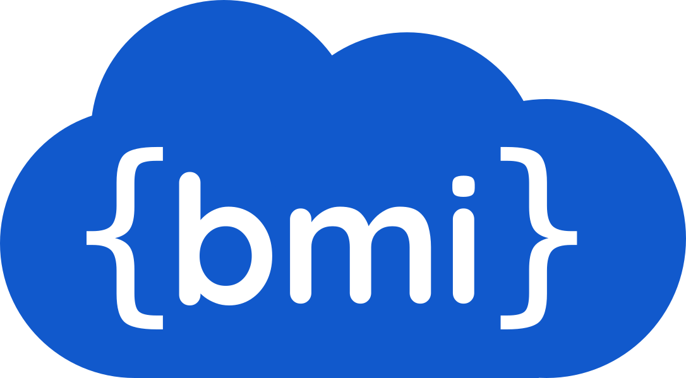

# Remote BMI



[](CODE_OF_CONDUCT.md)
[](https://app.codecov.io/gh/eWaterCycle/remotebmi)

Remote BMI allows you to communicate with BMI enabled numerical models using a RESTful API.

The [Basic Model Interface (BMI)](https://bmi.readthedocs.io/en/stable/) is a standard interface for models. 
The interface is available in different languages and a [language agnosting version in SIDL](https://github.com/csdms/bmi/blob/stable/bmi.sidl).

To have a consumer of the model and the provider of the model seperated you can use [grpc4bmi](https://grpc4bmi.readthedocs.io/), but this only works on languages that have a [gRPC](https://grpc.io/) implementation.
This repository replaces the gRPC protocol with an REST API.
The [REST API specification](openapi.yaml) is in the [OpenAPI](https://swagger.io/specification/) format.

## Usage

For Python and Julia implementations are available both for model providers and consumers.
R has a model provider implementation.
For usage examples see the [main remotebmi documentation](https://www.ewatercycle.org/remotebmi/).

Documentation for the available implementations can be found at:

- [Python](https://www.ewatercycle.org/remotebmi/python)
- [Julia](https://www.ewatercycle.org/remotebmi/julia)
- [R](https://www.ewatercycle.org/remotebmi/R)

For the OpenAPI specification [reference documentation](https://redocly.github.io/redoc/?url=https://github.com/eWaterCycle/remotebmi/raw/main/openapi.yaml) is available.

### Secure communication

Use an ssh tunnel to securely communicate with the remote BMI server.

For example, to forward local port 8000 to the remote server's port 8000:

```bash
ssh -L 8000:localhost:8000 user@remotehost
```

For Kubernetes deployments, you can use [port forwarding](https://kubernetes.io/docs/tasks/access-application-cluster/port-forward-access-application-cluster/) to securely communicate with the remote BMI server.

### Compression

Over slow Internet connections, it is recommended to use compression to reduce the amount of data transferred.

With ssh you can enable compression by using the `-C` flag, for example:

```bash
ssh -C 8000:localhost:8000 user@remotehost
```

For publicly accessible Kubernetes deployments, you can use an [ingress](https://kubernetes.io/docs/concepts/services-networking/ingress/) to compress data.

## Repository structure

This repository is a monorepo containing packages for different languages.
1. Python client and server, in [./python/](./python) directory
2. Julia client and server, in [./julia/](./julia/) directory
3. R server, in [./R/](./R/) directory

### Other languages

Any language that can run a HTTP server and parse/load JSON can be used as a provider.

The server should implement the [openapi.yaml specification](openapi.yaml).
